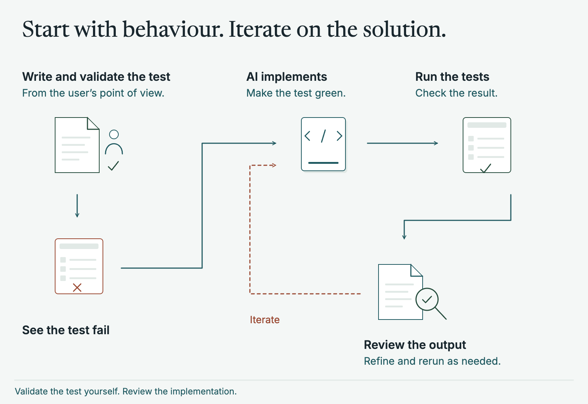
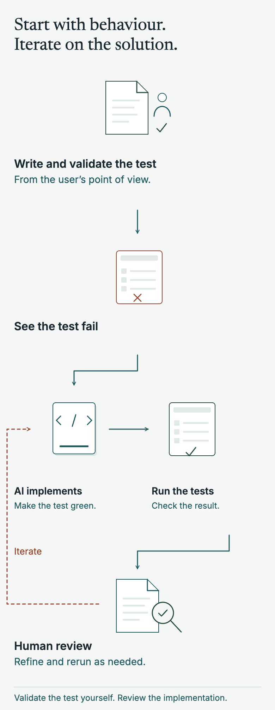
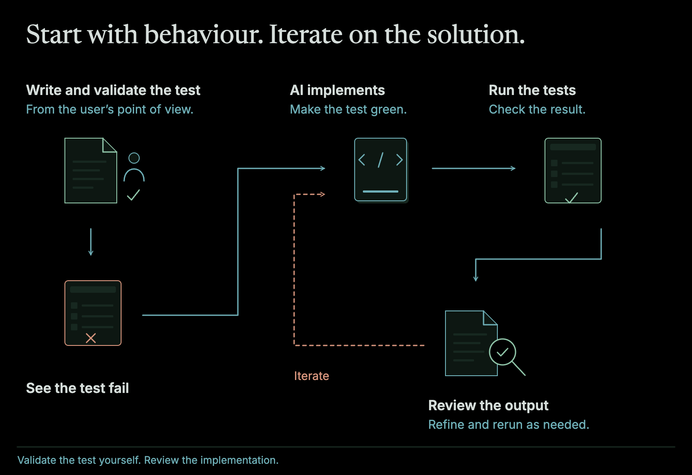
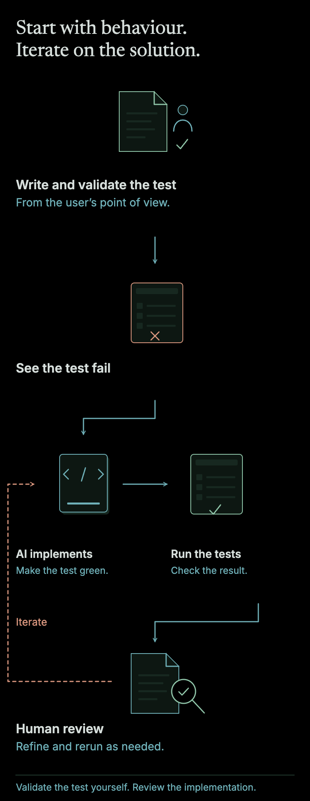

We have all heard of TDD (Test Driven Development). The process of starting with a failing test when you are writing code, build the code the test is targeting, making the test go green, repeat. It is a super effective tool that I have used many times in the past.

It has one problem though - it is generally focused at a unit test level. This to me, is too low level, it is too close to the implementation and not thinking about the broader picture. You miss out far too much of the system with this approach.

## Testing from the highest level possible

To me, the solution to this is Acceptance Test Driven Development. Something I really embraced after going to a training course hosted by [Dave Farley](https://www.continuous-delivery.co.uk/about).

The idea is that instead of testing from a unit test level (which is still important and useful!), move the tests up to the highest level of the system.

Typically this will look like driving the UI (via for example [Playwright tests](https://playwright.dev/)) and using the feature like a user end to end. It of course is not limited to UIs and I have also used this to test an API directly when appropriate. But the key idea stands: test from as high a level as required and feasible.

## Not a new idea

None of this is new, and I didn't come up with it. Dave Farley is one of the voices behind the continuous delivery movement. He [recommends](https://www.infoq.com/news/2017/04/acceptance-testing-delivery) writing acceptance tests as executable specifications in a domain specific language, run right at the boundary of the system, and he teaches a [four-layer approach](https://yowcon.com/melbourne-2022/masterclasses/371) to organising test infrastructure. The layering in this post comes from him, and I tuned it to be as lightweight as I could. If you want to learn more, I'd point you to his [website](https://www.continuous-delivery.co.uk/) and [YouTube channel](https://www.youtube.com/c/ContinuousDelivery).

The book [Growing Object-Oriented Software, Guided by Tests](https://www.growing-object-oriented-software.com/), by [Steve Freeman](https://higherorderlogic.com/) and [Nat Pryce](http://www.natpryce.com/), has a chapter called "Start Each Feature with an Acceptance Test". The Given/When/Then wording comes from [behaviour-driven development](https://cucumber.io/docs/bdd/history), and Playwright's own documentation suggests [page objects](https://playwright.dev/docs/pom) so that selectors live in one place.

Farley also describes protocol drivers, which let the same DSL drive both a UI and an API. I tried that on the audio installation software, but it added layers of interfaces and got complicated. These days I give the test separate DSL objects, one for the browser and one for the API, and let it drive each on its own.

The usual warning is the test pyramid. Martin Fowler [says](https://martinfowler.com/bliki/TestPyramid.html) to write far fewer high level tests than unit tests, because UI tests are brittle, expensive to write and slow to run. That is the problem the DSL is there to solve. That advice made sense before LLM tools, especially without a DSL, when suites like these got messy, flaky and eventually switched off. In my experience the DSL solves a lot of that on its own, and AI's pace takes away most of what is left.

## Driven from a DSL

This is all well and good, however we all know how these big UI test suites go - they get really large, hard to maintain, take forever to run. Generally they just get skipped, deleted, or ignored due to flakiness.

The solution I took from Farley is somewhat simple: introduce a DSL. Instead of writing Playwright directly in the test files, instead abstract it away. You end up with a flow like Test -> Given/When/Then -> DSL -> Playwright.

Tests cannot access Playwright, they are given the DSL via the test runner in an aliased Given/When/Then function. There's no [Cucumber](https://cucumber.io/) or [Gherkin](https://cucumber.io/docs/gherkin/) here. Given/When/Then is just plain functions, which keeps it lightweight while still reading like acceptance criteria.

DSL cannot access Playwright. Instead it is given other sub-DSL components or a single Playwright implementation that it proxies into.

Playwright implementations are just a collection of low level functions for a given page or component. Super self contained and deterministic.

Lint rules enforce all of this, so a test can't reach Playwright even by accident. I'd rather the build fails early than have spaghetti code build, so good practice is enforced with good, easy to understand linting.

What is the result? Extremely clean tests, a reusable DSL, understandable code. Because all code shares the DSL it means improvements made for one test improve all the tests.

## Sounds like a lot of boilerplate

It can be. However, even before LLM tooling existed I put this to good use in multiple projects.

The audio installation software is the pre-LLM one, and [there](/software/audio-installation-software/) more than 1,000 UI tests covered the whole application and took about 20 minutes to run. Since then I've used it on the frontend (not the Lambdas) of [build it again, but better](/software/build-it-again-better/), where over 200 stories drove more than 1,000 acceptance tests, and on [a recent AI feature](/software/ai-native-delivery/), where the tests weren't formally Given/When/Then but followed the same high-level idea. I've used it on Janggi too, below.

It really enabled engineers to think about how the user would use a feature / want from the feature. Rather than doing the typical thing of diving into a really low level solution, aka "into the weeds". Instead the engineers think about it from the top level - what does the user actually need.

This actually resulted in a lot of features getting rethought before any implementation code was written: maybe this isn't important, or the user would expect something different, or we should add this other bit. All the while having a foundation of "correctness" in the acceptance test ready to go.

On the audio installation software, for example, nobody had thought about how you accessed components and moved around between them. It wasn't in the flat UIs in [Figma](https://www.figma.com/) or the rough acceptance criteria in [Jira](https://www.atlassian.com/software/jira). Once we wrote it out as a test, slightly wired up to the DSL we already had, the gap was obvious.

## AI makes it faster, but also more important

With AI tooling this is of course much much faster to implement. The boilerplate is faster, creating tests is faster, building out the DSL is faster. It's so much easier.

<figure class="relative left-1/2 my-12 w-[min(62.5rem,calc(100vw-3rem))] -translate-x-1/2 [&_p]:m-0 [&_img]:w-full [&_img]:h-auto">

</figure>

However, it is also an incredible safety net when working with LLM based development. You start with the test, from a user's perspective. You validate the test yourself to ensure it makes sense. You then give the AI creativity for the solution to make the test go green. Review the output. Repeat in incredibly fast and effective loops.

What is the result? You are adding deterministic checks and regression proofing your code, while actively using (and embracing) an extremely non-deterministic way of developing software.

## An example you can look at today

If you look at my [Janggi](/software/janggi/) case study and [code](https://github.com/neil-armstrong-fig/janggi), I go into this in way more detail.
