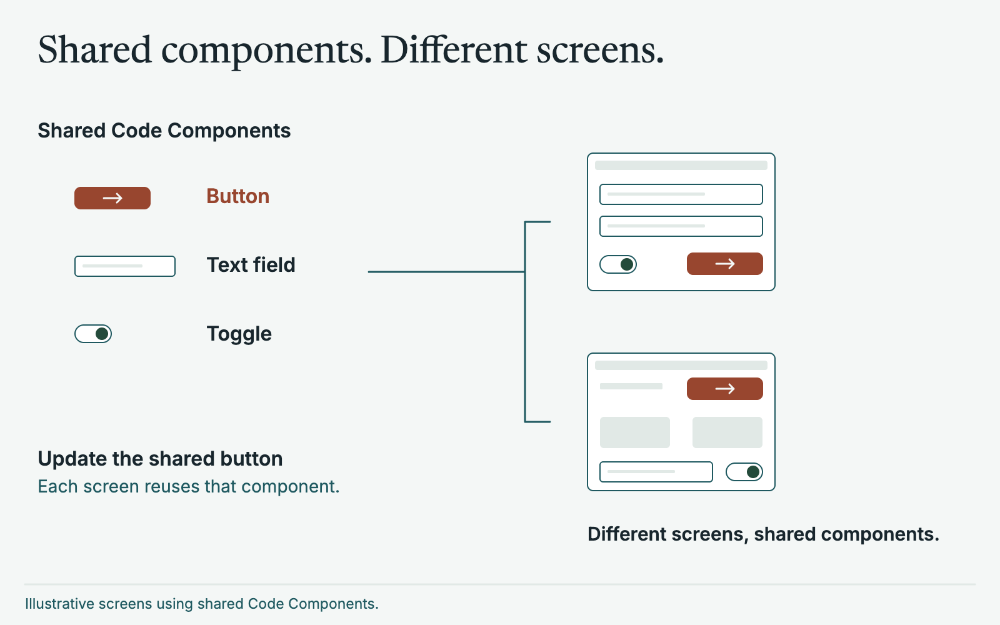
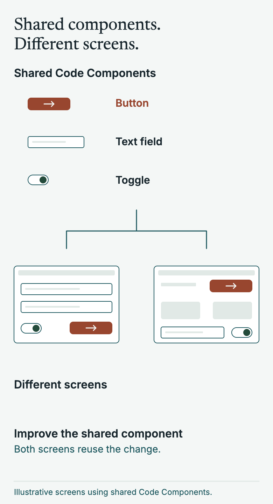
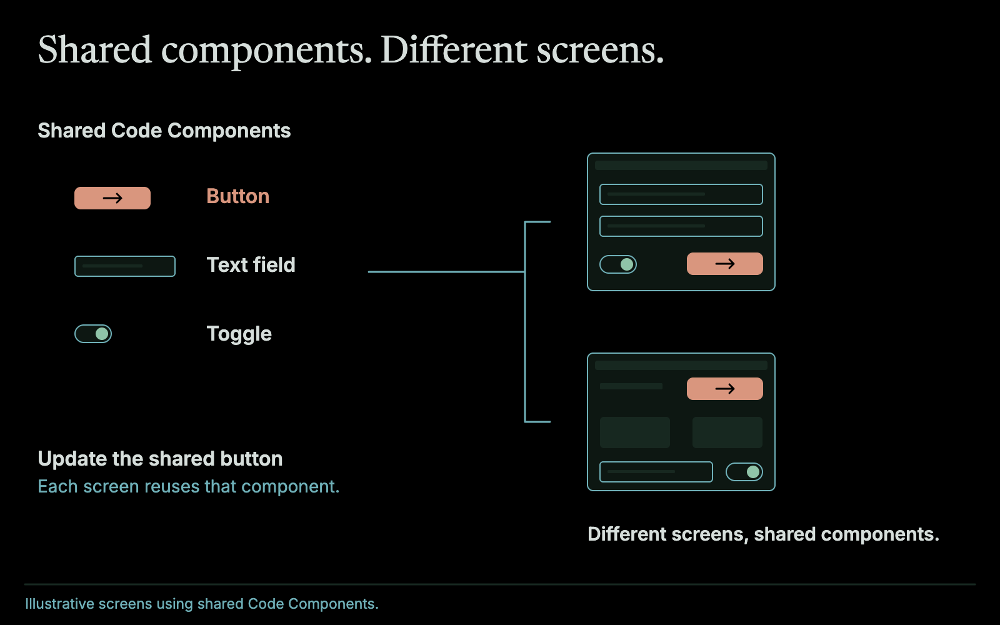
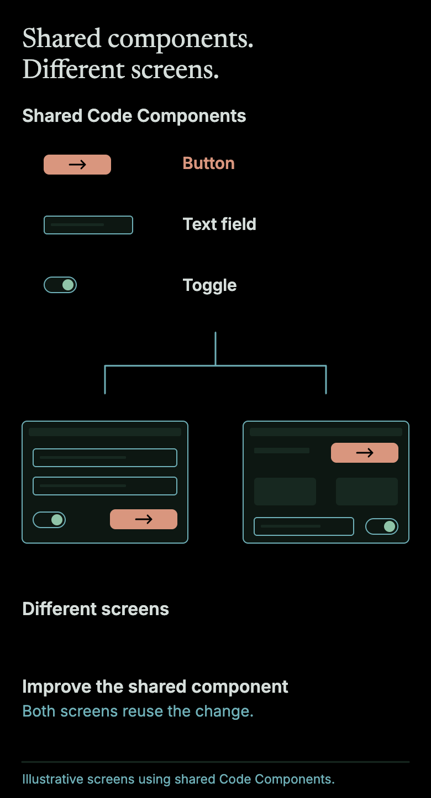

Having worked with product designers on multiple projects for many years I can say one thing very honestly: I love having designers on my team.

They produce amazing UIs, but also just incredibly thoughtful UX that I, as an engineer who will happily use a CLI all day, just wouldn't dream of.

They massively accelerate development by enabling engineers to focus on the thing they are good at: building incredibly scalable and easy to work on codebases that scale both in performance but also in delivery speed.

## Design systems

The IDE or work environment for a typical designer is the "Design System" - quite often these days in [Figma](https://www.figma.com/). This is where designers build out UI ideas, consider UX flows, define design tokens (colours, sizes, layouts, etc). It is their workbench.

Figma is a fantastic tool, and having a full design system to reference as an engineer is incredible. But this approach does come with issues.

## Out of sync

We want to enable designers on our teams to practice the same thing engineers practice: continuous improvement and continuous delivery. Designs are rarely right the first time and things always change (as they should!). However, engineers can get overwhelmed with working on so many other things that they often don't have capacity to go back and sync things up. This can cause friction and drift which weakens the Design System's utility.

I think everyone has seen this: what is shown on Figma is radically different from what is shown on the app. On the audio installation software the drag and drop had to be fully redone and redesigned to catch up, after the client approved new designs and UX in Figma. That took days.

## Code System mirrors the Design System

This is where I like to use the concept of a "Code System". This is a reflection of the design system. Each component defined in the design system has its mirror component defined in the code, with links in both Figma and the code linking to each other. I call those Code Components, just as the ones in Figma are Design Components, and together they make up the Code System. Using something like [React](https://react.dev/) makes this incredibly easy to do as it encourages really good componentisation of elements in your HTML.

Time is then spent in each sprint to review and update these components - highest priority first.

Designers can view the code system components in [Storybook](https://storybook.js.org/), interact with them, and suggest changes. On [the serverless insurance platform](/software/serverless-insurance/) every design-system component built in code was rendered in Storybook, and designers had full access, so a developer didn't need to attend validation sessions.

On [the audio installation software](/software/audio-installation-software/) each of more than 20 control panels was an implementation twin of its design-system component, so every option in the design existed in the code.

Tools now exist for much of the linking. Figma's [Code Connect](https://github.com/figma/code-connect) connects design system components in code with the design system in Figma. Storybook has a [plugin that links stories to Figma components](https://storybook.js.org/docs/sharing/design-integrations) and an addon that embeds Figma files in Storybook. [Style Dictionary](https://styledictionary.com/) exports design tokens to any platform. What I'm describing is the habit around them: a code twin for every component, and time set aside every sprint to keep it true, but you should 100% look into integrating and using these tools.

## What it costs

Keeping every component mirrored one for one takes effort, and it's easy to let it slip. That's why the time is set aside every sprint, and why the highest priority components come first. If nobody owns it, the two systems drift apart again and you're back where you started. LLM tooling takes a lot of that effort away, which I come back to below.

## Lego for everyone

This effectively turns building a UI into lego, both in Figma and in the application itself. This massively accelerates the idea of a [Fuzzy Frontend](/blog/fuzzy-frontend/) so that new features can be easily demoed, and you end up with an impressive library of components that are reusable, with enhancements and changes shared instantly throughout both systems.

<figure class="relative left-1/2 my-12 w-[min(62.5rem,calc(100vw-3rem))] -translate-x-1/2 [&_p]:m-0 [&_img]:w-full [&_img]:h-auto">

</figure>

## Keeping things in sync

Before LLM driven development I developed [my own tooling](/software/figma-sync/) to try to keep things in sync, which I wrote on the audio installation software. Syncing design tokens automatically from Figma into code by pulling via the Figma api. Doing design reviews to identify key areas that needed updating. It was at times a losing battle but it kept things mostly in sync.

## Supercharged with LLMs

Now, with LLM driven tooling, we can extremely easily keep things in sync. It takes hours to fully update a system.

That changes what keeping in sync is. Before, it was a project: bespoke tooling, scheduled design reviews, and a lot of effort just to stay roughly level. Now it is a task you can pick up on any day, so the sprint time set aside for the Code System goes much further.

Better yet, designers on the team can be fully empowered to make the changes directly - not happy with the UX of this component after it has been updated? Make the changes via [Claude](https://claude.com/product/overview) yourself, test in Storybook, update Figma from the Code System itself. True 360 degree updates.

I use [Claude Code](https://claude.com/product/claude-code) to make the changes, [Figma's MCP server](https://help.figma.com/hc/en-us/articles/32132100833559-Guide-to-the-Figma-MCP-server) so the agent can see the designs, and Code Connect to tie each design component to its Code Component.

In practice the loop looks like this:

1. A designer isn't happy with a component, in Figma or in Storybook.
2. They update the component in Figma until it is ready
3. They use Claude to update the Code Component
4. They try it in Storybook, across its variants and states.
5. Continue until things are correct
6. An engineer reviews the change, with the guardrails the codebase already has.

Ideally this is all automated. An agent raises a pull request with the updated Code Component based on recent changes in Figma, the pull request hosts its own copy of the updated Storybook for the designers to review, and nobody is involved in updating the code unless they need to be. Still using human review both from designers and engineers.

It is the same speed-up that makes a [Fuzzy Frontend](/blog/fuzzy-frontend/) so quick now. A component that doesn't exist yet doesn't have to be a rough stand-in. It can be built at close to finished quality in minutes, and it lands in the Code System ready for the next feature to reuse. Your Fuzzy Frontends are nearly 90% complete when you build them.

The guardrails matter more - not less - when the person changing a component isn't an engineer. Storybook gives designers a safe place to try things, the components are isolated from each other, and an engineer still reviews what goes in. Tests are the other half of the safety net. The same approach I describe in [Acceptance Test Driven Development](/blog/acceptance-test-driven-development/) applies here: write the check from the user's perspective, and let the AI make it pass. That is what lets you hand designers this power without worrying about what happens to the codebase.
