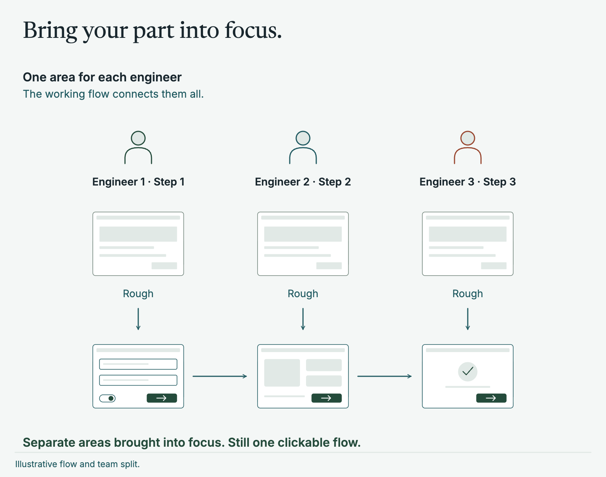
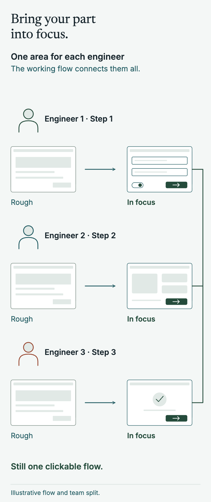
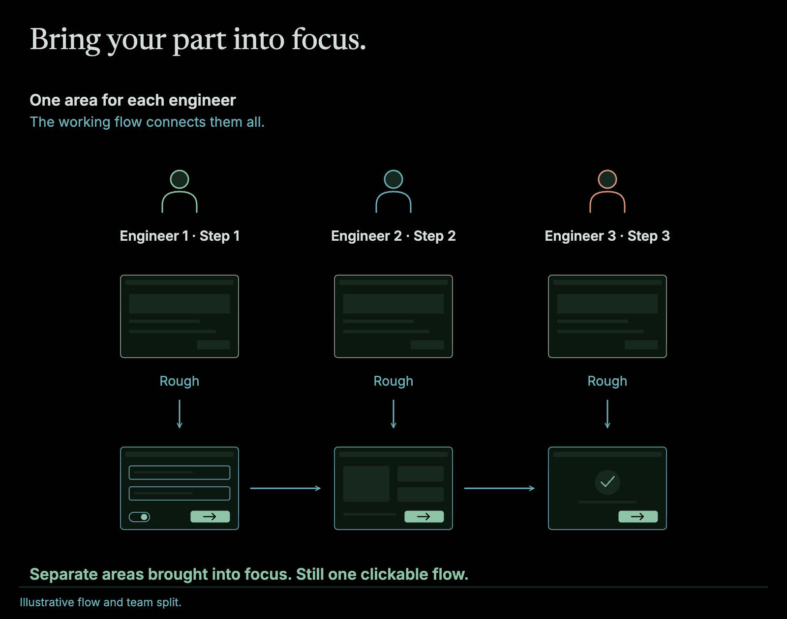
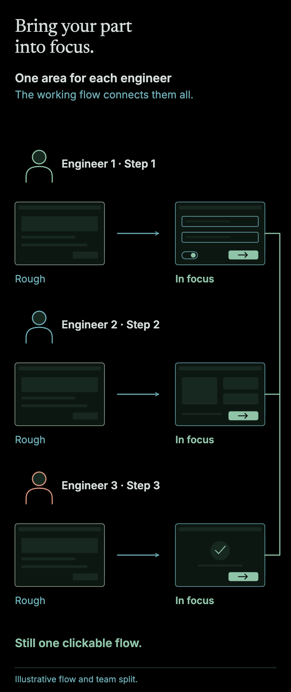

AI makes you build really fast. So why not build the whole feature and just deliver it?

But what if you go off on the wrong track? Deleting code and starting again costs far less than it used to, but it still costs something. I'd rather find out in hours I'm wrong rather than days after I've built the entire thing end to end.

## What a fuzzy frontend is

A fuzzy frontend is just the UI and UX of a feature, built end to end at low fidelity, with fake data and nothing behind it. Every screen exists and every path through the flow works, so someone can click from the start to the finish. Some parts are extremely rough. That's the point. You can demo it and get it validated before the rest of the work starts.

The name was coined by [Jason Karayiannis](https://www.linkedin.com/in/dotjk) while we worked together at [Instil](https://www.linkedin.com/company/instilhq). It came about as we needed examples to show customers quickly, and we managed to build out a super effective workflow to build out fake UIs for early demos.

## How I used it before AI

Without AI tools, building everything before anyone saw it was a big risk, because it took so long. So instead I found huge value in building the flow first. I used as many [Code Components](/blog/code-system/) as the system already had (design components from [Figma](https://www.figma.com/), built in code and kept in sync with the design). Where a new component was needed, I made a very rough version of it.

That gave us a full end-to-end flow to show a customer or user. This meant that stakeholders could really easily review, fill in gaps, challenge assumptions, and descope features that weren't needed super early in the process.

Then, once we are happy with the approach, the team could split it up to make that fuzzy frontend not so fuzzy anymore. Each person takes an area and brings it into focus, until it's no longer fuzzy, and nobody breaks the flow for anyone else because the whole thing already exists in a simple and limited capacity. Engineers build it as the user will use it so are always validating the UX from day 1.

<figure class="relative left-1/2 my-12 w-[min(62.5rem,calc(100vw-3rem))] -translate-x-1/2 [&_p]:m-0 [&_img]:w-full [&_img]:h-auto">

</figure>

Two of my case studies show it in practice. On [the platform modernisation](/software/platform-modernisation-back-on-track/) the screens were developer art with faked choices, and a hotkey let product and design jump to any step they cared about. On [the audio installation software](/software/audio-installation-software/) the same idea proved a concept quickly, and only then did we commit to full acceptance-test-driven development to create regression proof implementation in a really complex UI domain.

## Supercharged with AI

Now the missing components don't have to be rough. They can be built at close to finished quality, and a whole flow takes hours where it used to take days or weeks.

On a recent contract I had no [Azure](https://azure.microsoft.com/) access for the first two days. I generated 500 synthetic samples, ran a [Cosmos DB](https://azure.microsoft.com/products/cosmos-db) emulator on my machine, and built the flows with no API behind them. That first fuzzy frontend took about a day. By the middle of the first week I could demo the end to end flows to the team. They liked the extra features I'd added after my own testing, and we cut some they had originally scoped, because they would have been overkill. By the end of the week the frontend wasn't fuzzy any more, we had full end to end working software hooked up to AI models in Azure and databases. The full story is in [a case study](/software/ai-native-delivery/).

This can of course be taken a step further - if you have your environment prepped for it you can literally build out demos while on customer calls, that is just how fast AI can build out these fuzzy frontends when you have the right setup.

## Similar ideas

Like all great ideas, it is built on a cocktail of existing thoughts. There are a few well-known approaches that overlap with it:

- **Tracer bullets**, from [_The Pragmatic Programmer_](https://pragprog.com/titles/tpp20/the-pragmatic-programmer-20th-anniversary-edition/), push a thin piece of real code through every layer to see how close you land. A fuzzy frontend starts with the UI only.
- **[Shape Up](https://basecamp.com/shapeup)**, from [Basecamp](https://basecamp.com/), uses [breadboards and fat marker sketches](https://basecamp.com/shapeup/1.3-chapter-04) to keep early ideas deliberately low in detail, and [builds one vertical slice at a time](https://basecamp.com/shapeup/3.2-chapter-11) so something is demoable early. Those are sketches and word diagrams, where a fuzzy frontend can be clicked.
- **The Design Sprint** from Google Ventures builds [a realistic facade in a day](https://www.gv.com/sprint/) to test with customers. A facade gets thrown away. A fuzzy frontend becomes the product.

For me, I don't want to throw it away if it is good enough. It should be the foundation and starting point of the feature. It is an amazing tool not just for stakeholder engagement, but also slicing up the work so you can really accelerate delivery in a team bigger than 1.

## Accelerated by great designers

This approach is only accelerated by having amazing product designers on your team. When you focus on building out great synergy between a design system and a [code system](/blog/code-system/), it only speeds up the realism of your Fuzzy Frontend. Coupled with empowering your designers to build out these prototypes themselves via semi-vibe coding against your applications code base - in a controlled environment of course via Storybooks and isolated components - you can empower your team to make bold design decisions and keep designs in sync with the code.
