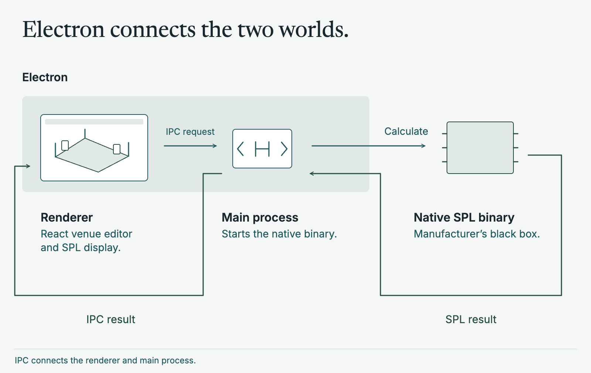
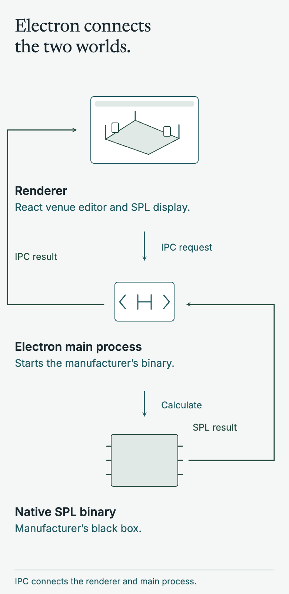
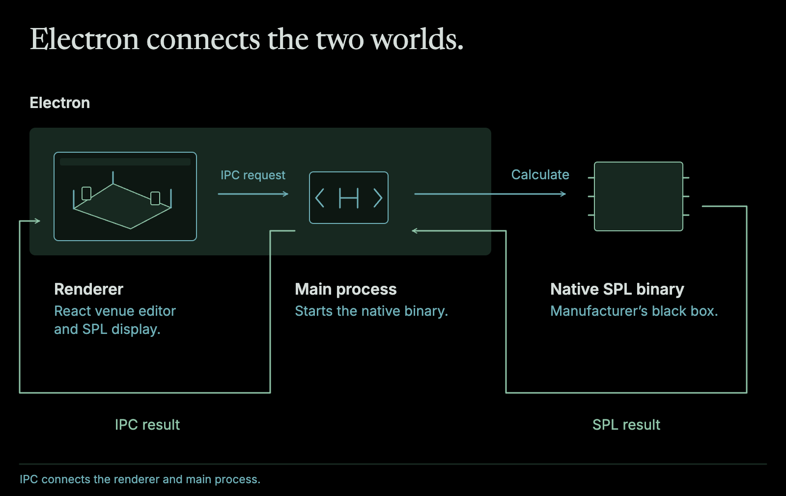
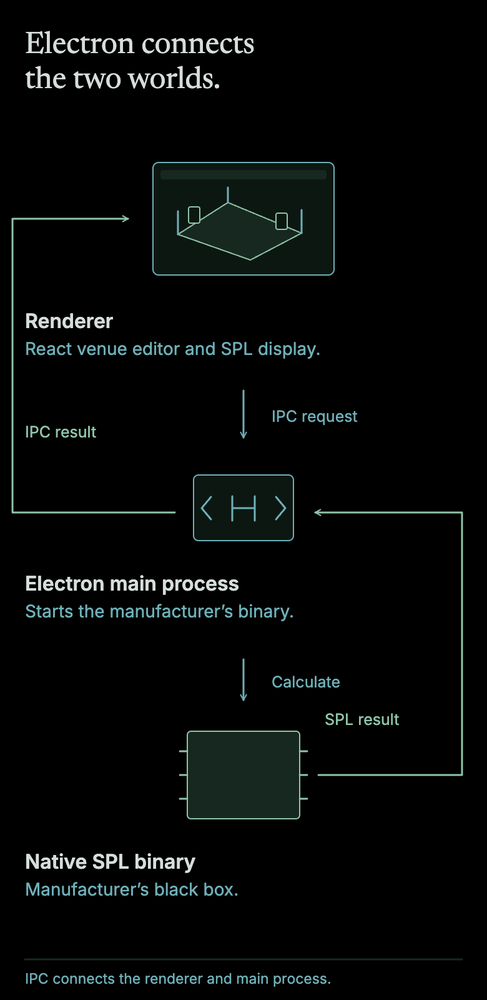

## A ground-up rebuild, cancelled at the finish

For a global professional-audio manufacturer, we rebuilt an extremely old tool for modelling sound pressure level (SPL) in 3D venues. We did it from the ground up, alongside an installation partner. The venue editor, speaker placement and SPL display all worked, and speaker arrays were starting to render in 3D. Then Covid made gigs and concerts uncertain and the project was cancelled close to completion. It turned out to be the wrong call, who knew.

I was there from the start of 2020 and stayed on after the cancellation to tie off loose ends into early 2021. I was promoted to principal during that close-out. The most useful thing I took away was how I'd structure the next one.

For the main build I was a senior engineer rather than a lead, on a team of about eight, with mentoring and some one-to-ones. I owned the approach to 3D modelling and abstraction, deployments and [Electron](https://www.electronjs.org/) bundling, developer experience and testing, and I was a key player on the difficult maths of rotating 2D planes in 3D space.

## The problem

Professional audio installation can be extremely expensive. You source the equipment, install it, then tune it until listeners get the sound they should. Is there another way? Can we simulate the venue and the equipment in software before anything is installed?

To be clear, this kind of software already exists. But like a lot of pro audio software it is extremely old, slow and perhaps not overly maintained any more. It also couldn't load the newer speaker algorithms, which was critical for this rebuild.

## Choosing the stack

The client assumed this needed a heavy [C++](https://isocpp.org/) desktop application because of the complex 3D rendering and SPL generation. There was a case for that. We looked at [Qt](https://www.qt.io/) because it was closest to what they knew, and at [WPF](https://learn.microsoft.com/en-us/dotnet/desktop/wpf/) because we'd built applications with it before.

We went with [TypeScript](https://www.typescriptlang.org/) and [React](https://react.dev/). Yes, we had experience in them, but mainly [three.js](https://threejs.org/) is just a great library for rendering. Electron packaged the result as a familiar desktop application, as a pure webapp was perhaps a bit too bold for audio engineers at this point. There was a hiring argument too. A bespoke C++ application is hard to recruit for, and web developers are much easier to find.

It also changed how we delivered. The client could look at a live web app at any time. TypeScript's great type support meant new people got to grips with the code very quickly, with the compiler as a safety net.

## The hard part: 3D inside a web app

SPL simulation needs 3D modelling. Installation engineers create a venue, place virtual equipment in 3D space and run the SPL algorithms to pre-tune the system. How do you do that in what is effectively a web app?

This was my main challenge. How do you make creating 3D venues easy? Any engineer should be able to work on what matters (the floor and the speakers) without thinking about 3D rendering.

three.js is the obvious answer, but I went a step further with [react-three-fiber](https://r3f.docs.pmnd.rs/), which renders three.js elements as React components. That let me hide the rendering behind a declarative layer. Engineers just worked with ordinary React components. There was still some low-level three.js underneath, and keeping it out of everyone else's way was my main job.

The same layer covered the behaviour that makes a 3D editor usable:

- camera controls, zooming and navigating the plane
- grid numbers that scale and move as you zoom
- undo and redo
- locked coordinates and pinning

It worked well. In demos and customer feedback the interface held up, and we could iterate quickly on the hardest part of the application. The first release targeted a standard club with perhaps two speaker arrays and a few cabinets, and the 3D rendering was smooth with no jitter. We designed for scale, up to full stadium sizes. We were still in the rapid build phase though, so we never battle tested it at that size.

## The SPL black box

The SPL calculation was a native "black box" binary from the manufacturer, so we couldn't write it ourselves. Electron has a main process and a renderer process. The main process started the binary and the renderer talked to it through IPC: renderer to main, then main to binary.

<figure class="relative left-1/2 my-12 w-[min(62.5rem,calc(100vw-3rem))] -translate-x-1/2 [&_p]:m-0 [&_img]:w-full [&_img]:h-auto">

</figure>

A result took a few seconds to populate. Still quick, but we were in the "get it working" phase so there was plenty of room to improve.

With the 3D layer behaving like normal React, the rest of the team could focus on the pipeline: draw a venue, place speakers, then see and edit the SPL for a good result. The interface looked like similar products with a more modern twist. A classic properties panel sat in a sidebar, and navigation down the left moved between screens and workflows.

## Testing, cancellation, and lessons

Acceptance testing wasn't part of my thinking on this project. We wrote a lot of unit tests and a few lightweight [Cypress](https://www.cypress.io/) tests where we could. Electron made UI tests pretty difficult.

Covid was the stated reason for the cancellation. The code was archived and the team moved on. There was talk of starting again once the pandemic eased, but the budget never came back, partly because of Covid. That leaves the client on extremely old software that doesn't work with the new signal processing.

The last 20% was still to come, and it always takes longer than anyone expects (the classic 80/20 rule). What I'd do differently is what I did on the next one:

- **Keep Electron thin.** I split the web app from Electron so Electron is only a wrapper. On [Reinventing audio installation software](/software/audio-installation-software/) the app ran fully as a web app without Electron, which made testing far easier.
- **Test the UI from the start**, using acceptance-test-driven development. [Janggi](/software/janggi/) is a further evolution of that idea, and you can explore it because it is open source.
- **Bring designers into the engineering journey** so they aren't abstract from the process.
- **Deliver fuzzy frontends end to end** and prototype as fast as possible.
- **Build clean abstraction layers** that let engineers do great work, as react-three-fiber did here.
