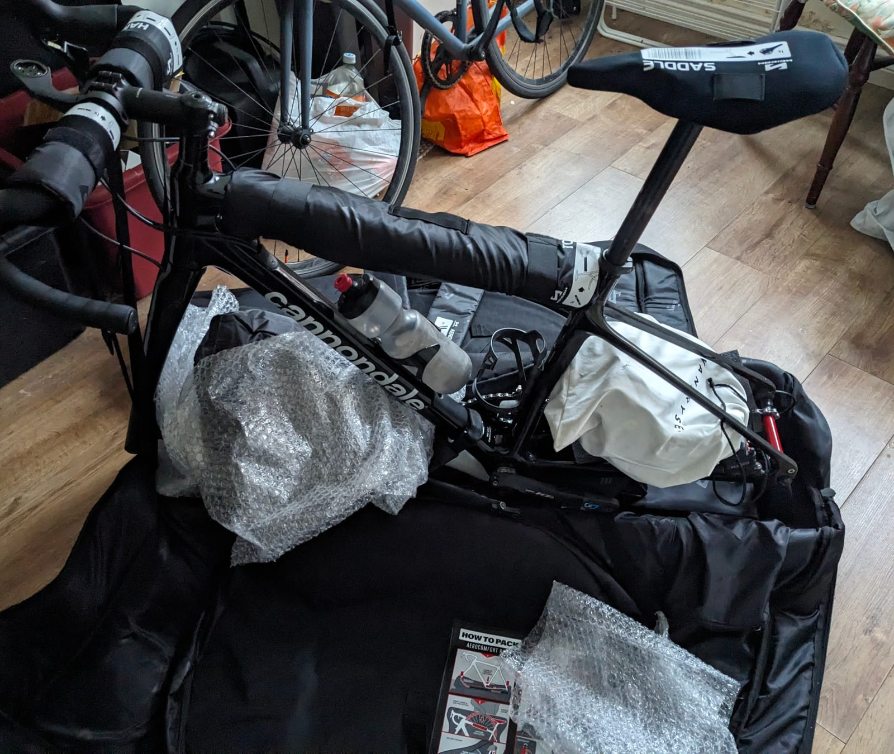
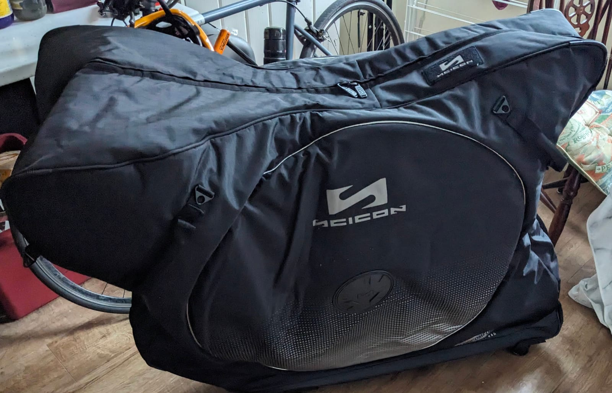
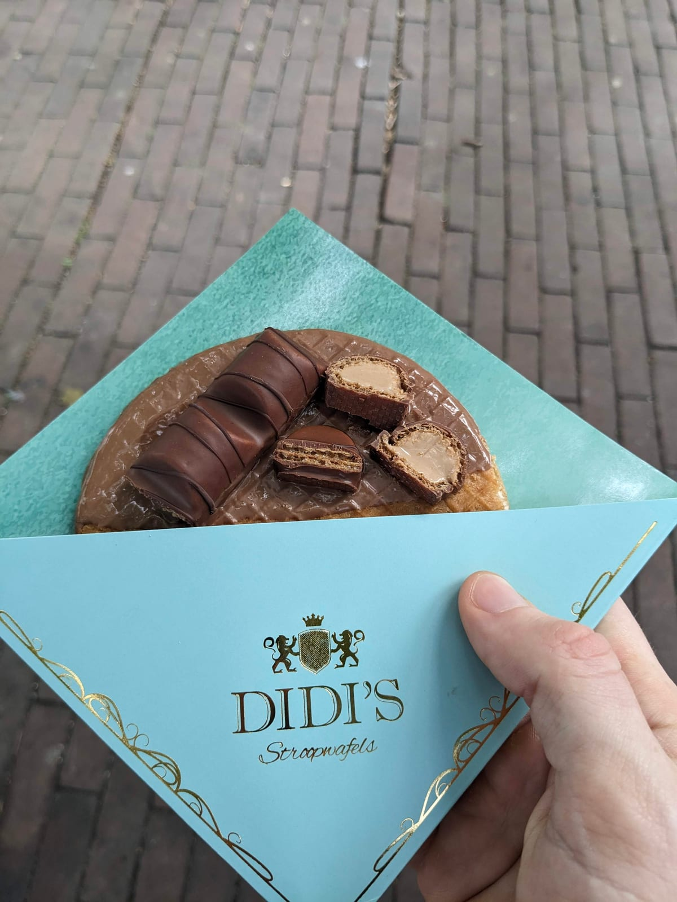
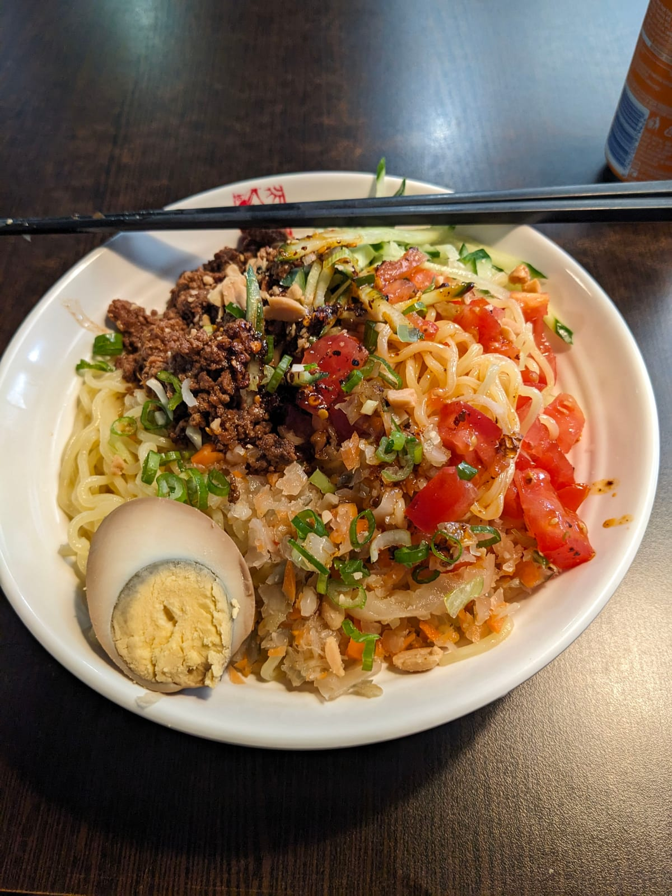
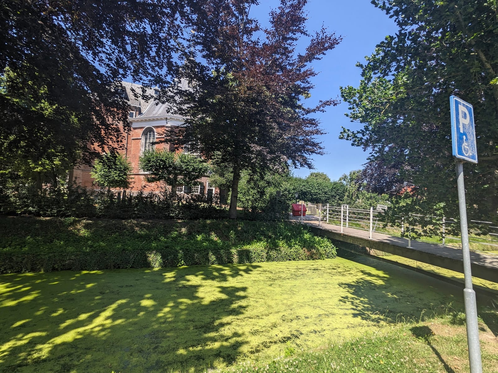
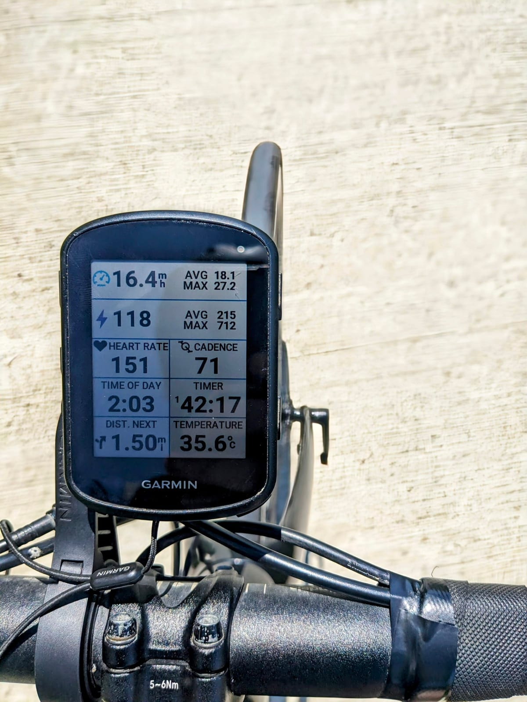
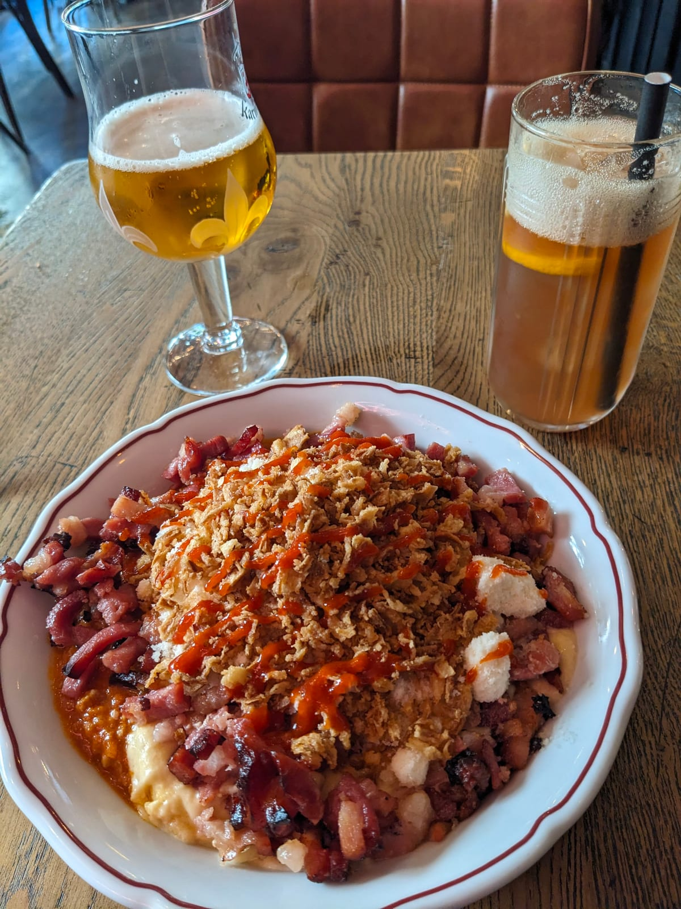
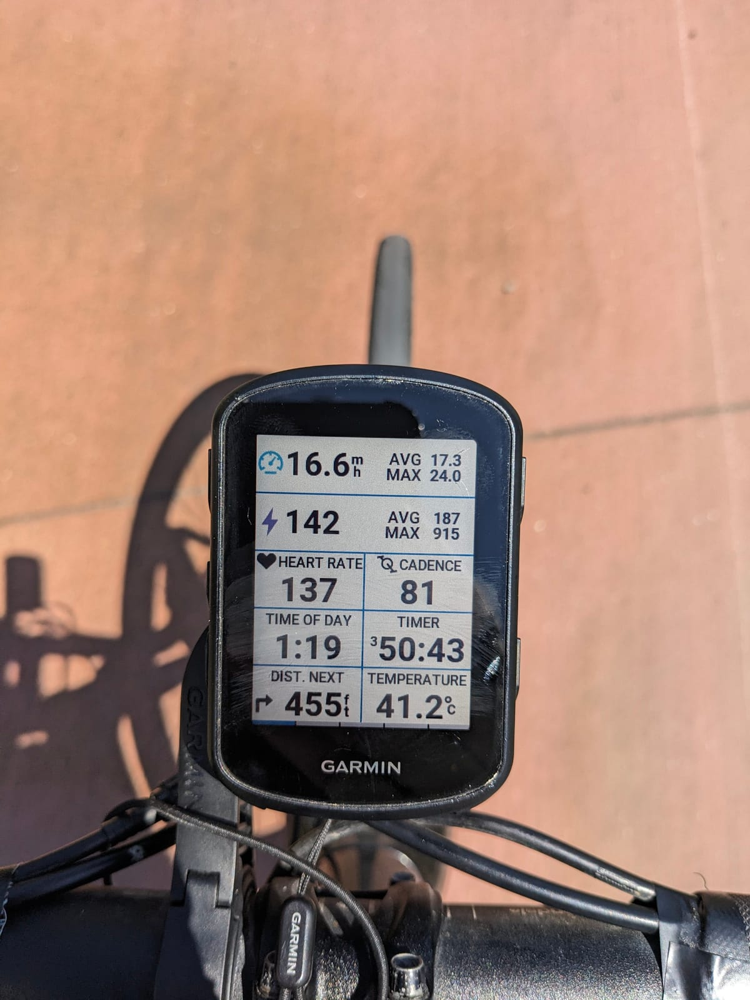
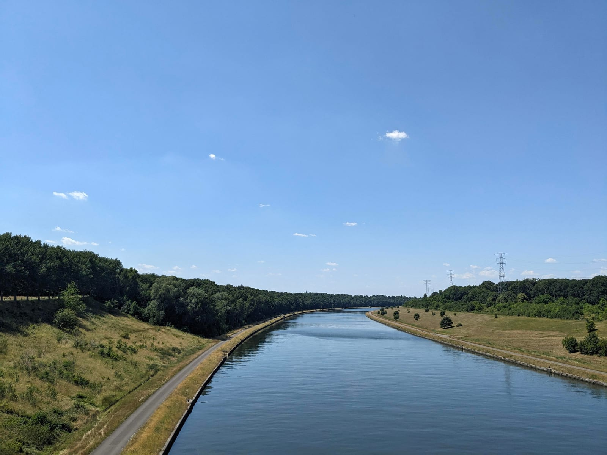
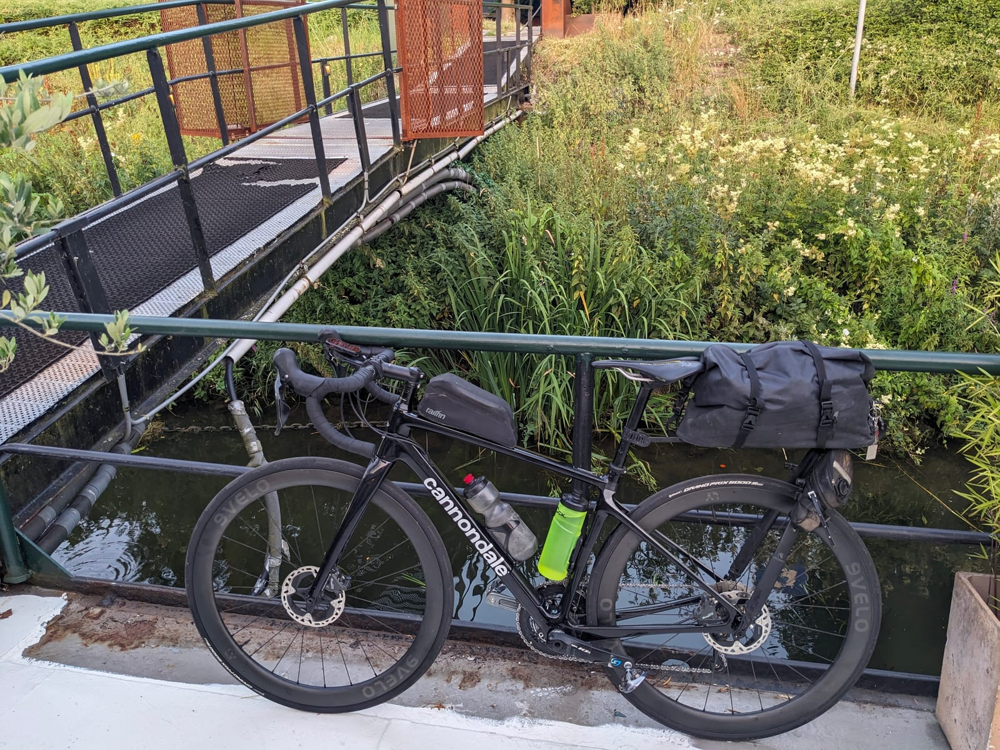

A fun get together with friends in Rotterdam, but why not extend it out for a little solo adventure on the bicycle?

This resulted in me buying a bicycle bag for the plane, a bit of a last minute purchase as was this plan!

I went for the [Scicon AeroComfort 3.0](https://uk.sciconsports.com/products/aerocomfort-3-0-road-bike-travel-bag-tp053105013). A soft bag, but seems to work well! The benefit is that it is a good bit lighter than a hard case so you can pack in bike packing gear too - though cardboard box is still a pretty good winner I think in a lot of cases!

I flew over from Belfast with the bike in the bag, and flew home again a few days after the ride.

Before the cycle, the classic staple of a stroopwafel (a very fancy one indeed!) and a tasty noodle bowl, both from Markthal in Rotterdam.

But it's time to get started!

## Day 1: Back to the best cycling infrastructure in the world!

_30 June 2025_

Damn does it feel good to be back on Dutch roads! Just so peaceful.

I've cycled here so many times, but time and again it always blows me away.

Though of course, any bike packing trip is not complete without a tunnel.

The lanes were incredible as always in The Netherlands, and it was actually going well until about the last 8 miles when the heat really started to hit. I was right smack in the middle of a heatwave ([_damn, I hope that never happens again…_](/cycling/loop-of-europe/)). So while it was super flat, it was an absolute hairdryer by the end. I guess heat training might be useful for the future?

Of course, after such a warm day well earned post ride hydration is always required.

I arrived in Antwerp! A really nice city, I have only ever been through the rather beautiful train station, and while this was just a short evening / morning visit, I absolutely want to come back!

## Day 2: Heat not fit for human consumption

_1 July 2025_

An eventful day, but not because of the cycling…

This was promised to be much hotter than day 1 (which I did question how that would be possible at the time). So, like a good cyclist, I got up super early to try to get as many miles in before the oppressive heat kicked my arse.

However, this plan was thwarted.

I did try to leave earlier, however when leaving the hotel I propped the back door open with my bike. However, the door had other ideas and wanted to shove my bike out of the way to close! So upon catching the bike as it fell the door slammed and the poor receptionist had no key to get back in! We were both stuck outside. Not a big deal for me, but they were screwed! "Very bad, this is very bad!"

So I couldn't just leave them stranded, they did let me leave super early after all. This meant I ended up throwing chocolate bars, stones, twigs, and eventually AAA batteries at another customer's 3rd floor window to get them to help. I am terrible at throwing things by the way so it was an epic failure.

Finally the other customer stopped getting annoyed at the noise and came to the window to shout "wtf are you doing?". The receptionist explained the situation. So this customer came down to try to help, but also ended up getting stuck at reception (the other side, another auto locking door) with no way out 😵 It was like an airlock so it went from "very bad" to absolutely awful situation!

More batteries thrown to get his girlfriend to also come to the window and also shout "wtf?". After another explanation they then came down and saved everything 😅

I had all my stuff - my bike and bags. So I _could_ have just scooted on... but felt I had kind of caused the situation so needed to help 😅

However, this meant I left _way_ later than I wanted. I'd planned on 6am and it was closer to 8am by the time I got going. Truly paid for my sins with the mistake in the morning…

My initial plan was to cycle along a canal all the way to Maastricht. Drop off my bags on the boat I was going to stay the night at, and then cycle down to the [highest point in the Netherlands](https://en.wikipedia.org/wiki/Vaalserberg) to round up to just over 100 miles.

However, there were two issues:

1. Obviously it was super hot, so I was getting toasted alive (this ginger whitest of white man is not built for such heat)
2. I was cycling along a canal most of the day, which means little to no shade the entire time. That is, while beautiful, absolutely punishing

So a lot of checking my map for “where is the next super market, I'm dying…” to both hide in the air conditioning (what an amazing feeling…) and buy about 6 bottles of water / juice / cola. Anything to bring me back to life.

Granted, it was another day of amazing paths. So who am I to complain?

And I end with an amazing view.

As I said though, my original plan was to drop bags and then cycle a good bit further but my body was just done with that brutal heat. I think I made the right call. It does mean I still haven't made it up to the highest point in the Netherlands. One for another time! Now to rest for the last day, sleep will be good. Right?

## The “botel”

When planning this trip I spied a cheap accommodation that looked kind of fun: a “botel”. Basically a boat on the river that they were using as a hotel, you staying in the various cabins. Pretty cool! And of course super cheap relatively speaking! How could I say no!

**Big mistake**.

I imagine it can be a really nice place to stay, especially if you get a proper inside cabin. The problem I had was I was on an outside cabin. It seemed to be the bit of the ship that didn't get any love: quite rusty in places, absolutely covered in spiders, and just a bit rickety in general. The room, for the most part, was quite nice though small. But weirdly a small window. I didn't really think anything of it once I had checked in and gotten settled though. I was so tired I presumed I would sleep well regardless!

I was wrong of course :)

The room refused to cool down from the blistering hot day. So when it was finally time for me to catch an early night, it was like entering a sauna. I actually think the room was hotter than outside somehow. So any time I managed to fall asleep, I was very soon awake again, massively overheating and needing to wipe myself down with a towel. Kind of felt like survival mode.

There was a single fan in the room, but I imagine it was just making it warmer rather than helping. At some points I decided to just try to sit / lay outside on the rusty bench on the side of the boat. It was somewhat better as it did feel a bit cooler, but being surrounded by so many spiders and rusty bits of metal didn't really fill me with comfort.

Well, back into the sauna I guess to try to get an hour or two at least…

## Day 3: Rotterdam to Rotterdam complete!

_2 July 2025_

Thankfully, I survived the boat shaped sauna. I still think it'd be a fun experience, but yea, perhaps never again for me :) At least I got so fed up I just got up super early to avoid day 3's heat!

Which, for someone like me who does struggle to get up early, what a treat that is to see…

This was a big day out, 117 miles all the way back to Rotterdam. I was rolling by 5:52am and back in Rotterdam just before 3pm. Not quite as toasty as yesterday but still a brutal auld day out, with barely any food due to the heat killing my appetite. Always got to get at least one ton in though! However as always the country doesn't disappoint on lanes.

One thing I will say. While the Netherlands (and just slightly less so the Belgium - yes Netherlands has better cycle lanes!) has amazing infrastructure, the only thing it really lacks are some nice hills to look at. Will have to get my fix some other time!

## Mini adventures are still adventures

All in all, a nice 3 day mini adventure. Also nice to get the Cannondale out for a last spin before it is relegated to the backup bike :) It has served me well…
